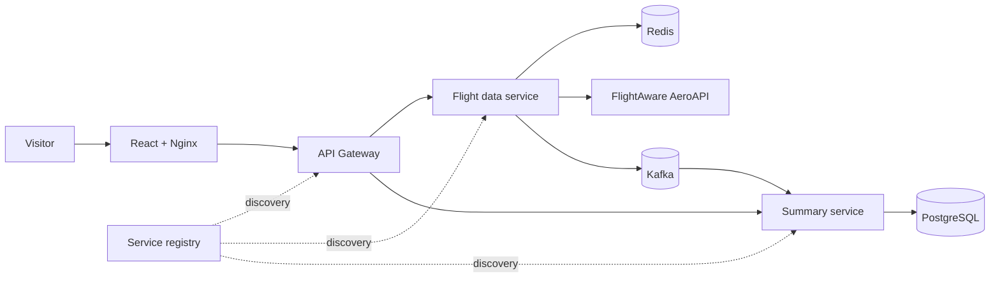

# Architecture

This is an academic portfolio system with four Spring services and a React client. The structure demonstrates service discovery, an API gateway, a flight provider client, Redis caching/limits, and an event-driven summary service. It is not a claim that microservices are necessary for a production traveler product.

## Candidate and summary flow

1. Browser requests `GET /api/v1/flight/{ident}/candidates` through Nginx and the gateway.
2. Gateway applies a Redis token bucket by client address. The flight service checks the cached candidate list by uppercase ident; cache entries expire after five minutes. Live lookup uses FlightAware's ordinary `/flights/{ident}` endpoint without a date-range parameter; FlightAware says ordinary endpoints generally return 48–72 hours by default, though the window varies by endpoint.
3. On a miss, FlightAware AeroAPI returns a list. The service preserves candidates, airport metadata, last-position timestamps, and a `checked_at` timestamp. Provider HTTP failures remain distinguishable from an empty result.
4. The visitor selects one returned instance. The details endpoint resolves that ID only among candidates with the matching ident.
5. The browser requests `GET /api/v1/flight/{ident}/summary/{faFlightId}`. If no summary exists, it posts the selected ID to the summary retry route; the flight service publishes only that instance, keyed by `fa_flight_id`.
6. The Kafka consumer generates a summary and stores it by unique `fa_flight_id`. The browser polls for at most about 20 seconds and then shows a retry action.

The legacy ident-only flight and summary endpoints remain for compatibility. They return a conflict when their service knows there are multiple candidates.

## Profiles

- `demo`: Flight service serves local fixtures; summary service returns clearly labeled fixed text. No external flight or LLM request is made.
- `prod`: provider clients are enabled and fail startup if keys are absent. This is a live-provider profile, not a production deployment recipe.

## Boundaries and unresolved behavior

- Redis cache values use a typed JSON serializer for candidate lists; arbitrary Jackson default typing is not enabled.
- Gateway and provider quotas use Redis and reject requests when quota storage is unavailable.
- Only a selected flight is queued for summary generation. OpenAI calls have a global Redis-backed per-minute, per-hour, and per-day quota; these are volume guardrails, not a provider billing cap.
- Compose publishes the frontend, gateway, Prometheus, Grafana, and Zipkin to loopback only; all internal services share one bridge network. Prometheus scrapes the four Spring services' actuator endpoints.
- Kafka persistence/retry, database migrations and restoration, provider freshness, runtime behavior on a clean Compose start, and load capacity still need end-to-end evidence.
- Automatic Kafka publication is asynchronous and can fail after the search response. The explicit retry endpoint waits up to three seconds for broker acknowledgement and returns an error when the broker does not acknowledge; both paths still need a running-broker test before deployment.
